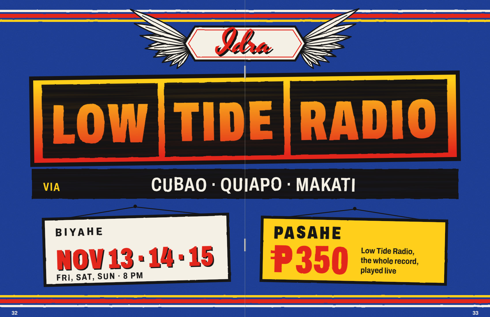
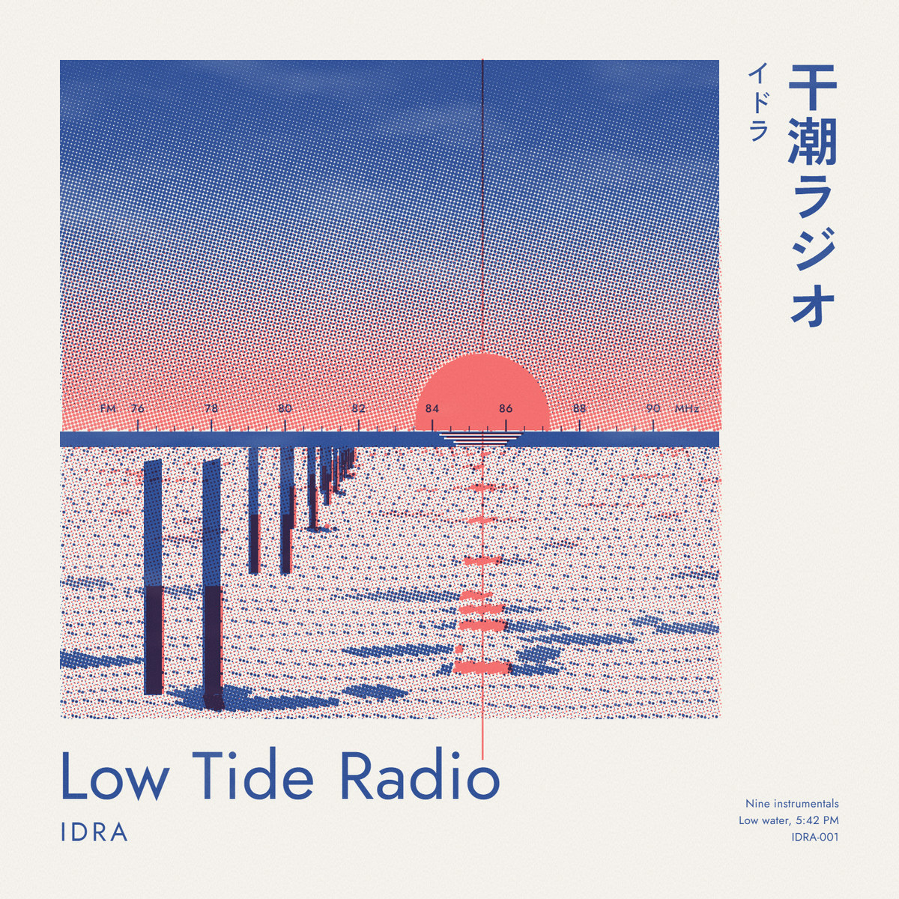
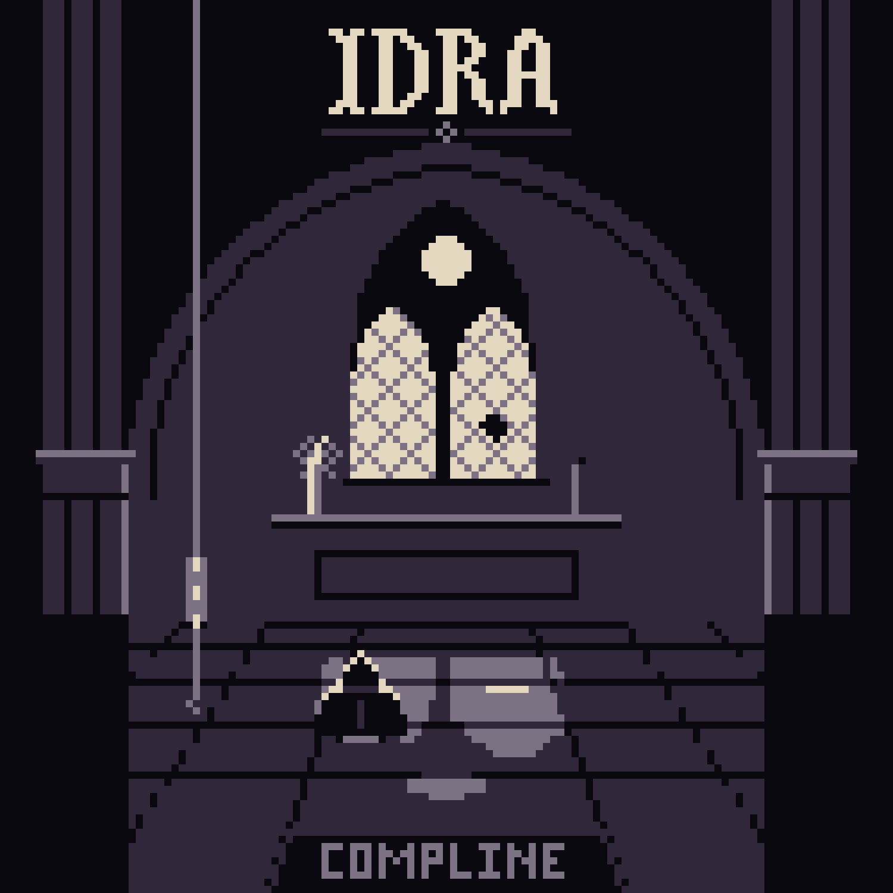
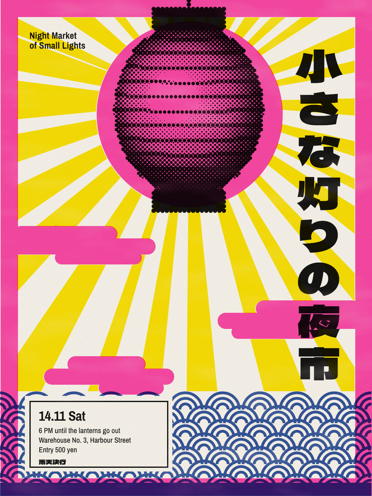

# idra-taste

Art direction for Claude Code that makes design look made by a designer, not by a model.

Generated design is easy to spot: default fonts, screen gradients, even spacing, perfect edges, and no medium behind any of it. idra-taste grounds every piece in three things a designer can name: **the subject**, **a real medium** (risograph, silkscreen, offset, photocopy, airbrush, pixel screen) and **a real movement**. It then adds honest print marks and reviews the output the way a print designer would.

It works for any format: posters, covers, flyers, zines, labels and packaging, social posts, decks, editorial layouts, web pages, pixel art and motion.

## Made with idra-taste

Each piece below came from a short brief in a single Claude Code session, was rendered with `shot.mjs` and went through the keen-eye review. Each one starts from a different medium and movement.



**Biyahe**, magazine centrefold, 17 x 11 in. Jeepney signboard lettering from the Philippines: box letters that let the painted yellow-to-red board show through, a winged name plate, and the ticket price as the fare.

<table>
<tr>
<td width="33%" valign="top"></td>
<td width="33%" valign="top"></td>
<td width="33%" valign="top"></td>
</tr>
<tr>
<td valign="top"><b>Low Tide Radio</b>, 12-inch sleeve. Two-drum Risograph: fluorescent orange and blue overprint to violet, and the horizon is a 1980s FM dial.</td>
<td valign="top"><b>Compline</b>, cassette cover. Gothic 4-shade pixel art: a 125 x 125 screen in four colours at 12x, every pixel and letter placed by hand.</td>
<td valign="top"><b>Night Market of Small Lights</b>, gig poster. Japanese psychedelic silkscreen: spot inks, a halftone lantern and vertical type.</td>
</tr>
</table>

## How it fits together

| Layer | Provided by |
|---|---|
| Art direction: movement, inks, type, rules | **idra-taste** style library (16 movements plus a template for new ones) |
| Print marks: ink layers, drift, grain, density, paper, halftone, dither, toner | **idra-taste** `print.js` (seeded, no dependencies) |
| Review: keen-eye checklist, grayscale and thumbnail renders | **idra-taste** |
| Web UI principles | frontend-design (Anthropic), installed separately |
| Web page and app screen run, real-browser inspector | taste-skill (Leonxlnx), installed separately |
| Slop detector, critique and polish commands | Impeccable (Paul Bakaus), installed separately |
| Motion | idra-motion |

The other plugins are installed from their own sources, never copied in. See `THIRD-PARTY.md`.

## Install

In Claude Code:

```text
/plugin install idra-taste --marketplace bbrainfuckk/idra-taste
```

Or from a terminal:

```bash
claude plugin marketplace add bbrainfuckk/idra-taste
claude plugin install idra-taste@idra-taste
```

For the full set (idra-taste plus frontend-design, Impeccable and taste-skill), clone the repository and run:

```bash
sh setup.sh
```

Start a new Claude Code session afterwards so the skills and hooks load. Note that Impeccable adds hooks to every session; `references/toolbox.md` says how to turn them off per project.

To update a local clone after editing it, bump `version` in `.claude-plugin/plugin.json`, then:

```bash
claude plugin marketplace update idra-taste
claude plugin update idra-taste@idra-taste
```

## Use

Invoke `/idra-taste:idra-taste` or describe the job; the skill triggers on design requests that need taste. A good brief names the subject, the audience and the output:

```
Design a 1200 x 1600 px gig poster for <band>, playing <venue> on <date>.
Audience: people who collect Japanese posters and riso prints.
Use idra-taste. Pick the movement that fits the band's sound, explain the choice in one line,
then build it, render it, and run the keen-eye review before you show me.
```

```
Redesign this landing page so a graphic designer would respect it.
Keep the content and the logo. Use idra-taste for direction and the taste-skill run for the page.
```

Every delivery comes with short design notes: medium, movement, inks, fonts, and where each major decision came from.

## Style library

Constructivist and Bauhaus, Polish poster school, Atelier Populaire 1968 (Paris), San Francisco psychedelic, Blue Note jazz, acid rave flyer, xerox punk, riso zine, jeepney signboard (Philippines), Japanese psychedelic poster, Japanese editorial grid, city pop airbrush, Showa retro label, PC-98 pixel art, gothic 4-shade pixel art, Y2K Japanese web. Each recipe gives the medium, inks with hex values, open fonts, composition habits, the marks the medium allows, and the tells of a fake.

New movements are researched and written with `styles/_template.md`.

## Layout

```
.claude-plugin/          plugin and marketplace manifests
skills/idra-taste/
  SKILL.md               the run: brief, direction, system, build, look, deliver
  styles/                one recipe per movement, plus _template.md
  references/            imperfection rules, keen-eye review, type, colour, toolbox
  assets/print.js        print-mark engine
  assets/starter.html    sheet template with ink layers
  scripts/shot.mjs       render to PNG or PDF with headless Chrome or Edge
  scripts/serve.mjs      local http server for pages that read images
media/                   the gallery images in this README
setup.sh                 installs idra-taste and its companions
```

## Licence

Source available, not open source ([LICENSE](LICENSE)). You may read idra-taste and run it, unmodified, to make your own work, for personal or commercial projects, with no fee, including through an AI agent with the skill. You may copy `print.js` and `starter.html` into your projects as the skill directs. The work you make is yours. You may not copy, change, share, sell, host or rebuild idra-taste itself. For any other use, write to marvin@idra-ai.com.

Libraries named in the toolbox have their own licences, and some limit commercial use; `references/toolbox.md` lists which.
